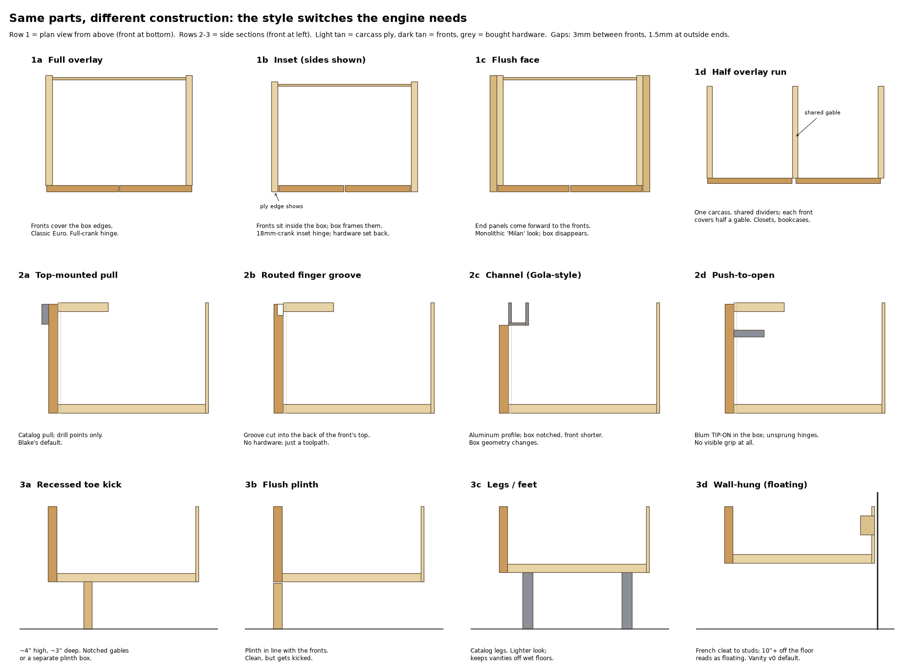

# Plywise

*Built for your walls.* **Scan a room with your iPhone, get modern European cabinetry designed for that exact space, see it life-size in AR, and send CNC-ready files to a shop.**

Contemporary Euro cabinets (vanities, built-ins, closets, bookcases) are all the same parametric box, assembled in different combinations of doors and drawers. This project turns that idea into code:

- **`engine/`**: a TypeScript cabinet engine. A short spec ("36-inch floating vanity, two drawers, walnut fronts, vessel sink") becomes every panel, dado, hinge cup and drawer-slide hole, then a CNC job package: layered DXF per sheet (VCarve/Aspire-ready), cut list, hardware list, quote, and a 3D model. 47 tests, including one that checks every place two parts overlap was actually machined for the joint.
- **`app/`**: the iPhone app (Swift, RoomPlan, RealityKit). Scan the room with LiDAR, tap a wall, and the cabinet locks onto it with real wood textures. Walk around it, open the finish menus, slide it into place.
- **Built for flat-bed 3-axis CNC routers**: face-only machining, no edge boring, tool-grouped operations for machines without a tool changer. Any small shop with a router can cut these.



## Try the engine
```
cd engine
npm install            # dev tools only (TypeScript); the engine itself has no dependencies
npm run samples        # builds every spec in engine/specs/ into jobs/
npm test
```
Open `jobs/<name>/preview.html` to spin a design around (switch finishes, open the drawers), and `jobsheet.html` for the shop sheet. Node 24+ runs the `.ts` files directly.

## Docs
- `STYLES.md`: the 8 construction "switches" every modern cabinet style reduces to
- `engine/README.md`: engine architecture, spec format, tests
- `engine/VCARVE.md`: cutting a job in VCarve + Mach3
- `APP_PLAN.md`: how the iPhone part works (LiDAR, ARKit, RoomPlan) and the milestones
- `CLAUDE.md` / `SESSION.md`: project handoff and history

## Status
Engine v0.x: vanities, sideboards and built-in boxes are designed, nested and exported. The first test cut is pending a hinge test on the reference shop's machine. App v0.1: scan, tap a wall, place and view (TestFlight).

Hardware data (Blum CLIP top, TANDEM) comes from Blum's published specs. Values not yet confirmed are flagged in `engine/catalog/*.json` and printed on every job sheet.

## License
Apache License 2.0. See `LICENSE`. Use it, build on it, ship it; contributions welcome.

Wood textures: [ambientCG](https://ambientcg.com), CC0.
